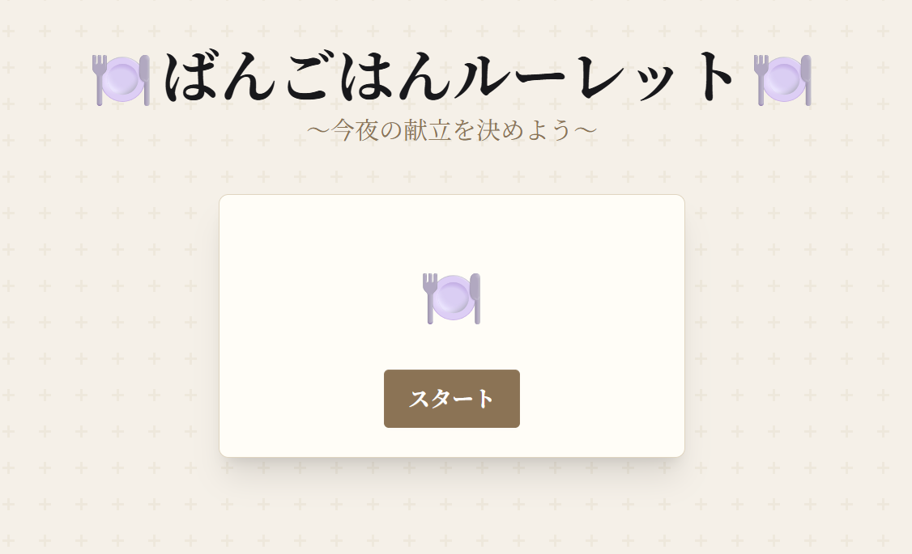

## ばんごはんルーレット
### 1. アプリURL
https://bangohan-roulette-web-fvxv.onrender.com/

### 2. アプリ紹介
今日の晩ご飯をルーレットで決められます。
RUNTEQで学習した内容をもとに、初めて制作したミニアプリです。
「スタート」ボタンを押すと、晩ご飯のメニュー名と必要な食材が表示されます。

### 3. 使用技術
| 分類 | 技術 |
|------|------|
| バックエンド | Python 3.12 / Django 5.2 |
| データベース | PostgreSQL 16（本番：Neon） |
| フロントエンド | TailwindCSS v4 / daisyUI |
| 開発環境 | Docker / Docker Compose |
| デプロイ | Render / Gunicorn / WhiteNoise |